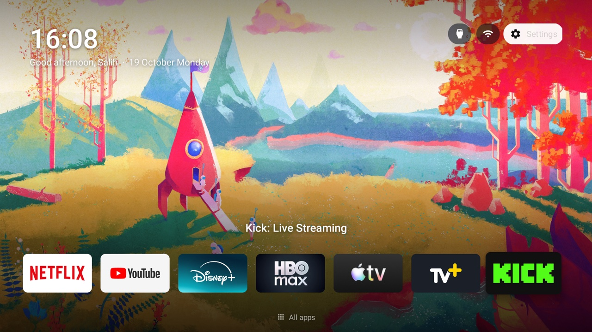

# tv — make a slow Google TV fast again, without losing anything

[Türkçe](README.tr.md)

A 2 GB-RAM Google TV (TCL 50C645, Android 11) that took seconds to open an app and reloaded
everything from scratch after every switch. Two things fixed it, both reversible, nothing deleted:

1. **`tvclean.py`** – a small ADB-over-Wi-Fi tool that puts the manufacturer's ads, telemetry
   and "cleaner" apps to sleep in supervised batches, with a protected list it refuses to touch,
   a snapshot before every change and a one-command restore.
2. **`launcher/`** – a 3.7 MB Apple TV-style home screen: a dock of your apps, time-of-day
   wallpapers, inputs/Wi-Fi/settings pills, no content rows, no network access.



## What it changed on this TV

| | Before | After |
|---|---|---|
| Free RAM, idle on the home screen | 440 MB | 616 MB |
| Swap in use | ~500 MB | ~110 MB |
| Home screen process | 333 MB (Google TV) | 36 MB |
| Packages starting at boot | 51 | 37 |
| TCL background services resident | ~300 MB | 0 |
| TCL "Safety Guard" killing Play Services | 11× in 5 min | gone |

Everything the owner used kept working: HDMI/AV inputs and their names, Live TV, the remote's
mic, Source and Settings keys, Chromecast, T-Cast and Miracast mirroring, USB media, Assistant,
Play Store, system updates.

## Safety model

- System packages are never uninstalled. They are **disabled for the user** (`pm disable-user`),
  which stops them running and costs nothing; `pm enable` brings them back. Factory reset also
  restores everything.
- [`protected.py`](protected.py) lists packages the tool **refuses** to disable even if a plan
  file names them: inputs, remote, casting, Assistant, Play services, keyboards, updates.
- Every mutating command writes a snapshot of all package states to `snapshots/` first;
  `restore <snapshot>` returns the TV to exactly that state.
- Every mutating command is a **dry run** until you add `--yes`.
- The only exception to "disable, never remove": TCL's Safety Guard is a `PERSISTENT` app that the
  system starts even while disabled, so it is removed *for the user only* (`pm uninstall -k --user 0`);
  its APK stays on the system partition and `readd` restores it.

Things we learned the hard way, now built into the tool:

- Rebooting within a few seconds of a `pm` change loses that change (the package manager flushes
  lazily). `tvclean.py reboot` waits first.
- adb-shell's file push times out on this TV's adbd; APKs go over the shell as base64 chunks with
  an md5 check.
- On Google TV, `cmd package set-home-activity` alone **cannot** make a third-party home take the
  Home key: Android picks the highest-priority HOME activity (Google's launcher has priority 2,
  the setup wizard 1, third-party apps are capped at 0) before it even looks at the preference.
  The stock home and setup wizard have to sleep. Both come back with one command.

## Requirements

- macOS or Linux with Python 3.10+ (no `adb` binary needed; the Wi-Fi client is pure Python).
- For the launcher: JDK 17 and the Android SDK command-line tools with `platforms;android-34`
  and `build-tools;34.0.0` (`build.sh` reads `ANDROID_HOME`, defaults to the Android Studio SDK path).
- An Android TV / Google TV on the same Wi-Fi with **USB debugging** on:
  Settings → System → About → press OK on *Build* 7 times → Developer options → USB debugging.

## Quick start

```bash
git clone https://github.com/salih-g/google-tv-light.git && cd google-tv-light
python3 -m venv .venv && .venv/bin/pip install -r requirements.txt

.venv/bin/python -I tvclean.py find        # finds the TV, saves its IP to .tv_host; accept the prompt on the TV
.venv/bin/python -I tvclean.py probe       # model, Android version, RAM, which app owns Home
.venv/bin/python -I tvclean.py snapshot baseline
```

### 1. Debloat, batch by batch

The plan files in [`plans/`](plans/) are the ones applied to a TCL 50C645 (R51MT05 firmware).
Other TVs have other packages: run `tvclean.py shell 'pm list packages'`, read
[`plans/README.md`](plans/README.md) and write your own lists. Then, one batch at a time:

```bash
.venv/bin/python -I tvclean.py mem                               # before
.venv/bin/python -I tvclean.py sleep plans/02-sleep-tcl-resident.txt        # dry run: shows the commands
.venv/bin/python -I tvclean.py sleep plans/02-sleep-tcl-resident.txt --yes  # apply
```

After each batch, test with the remote: input switching, mic, Chromecast, a streaming app,
the on-screen keyboard. If anything broke: `wake <same plan> --yes`.

```bash
.venv/bin/python -I tvclean.py reboot --yes     # waits for the package manager, then reboots
.venv/bin/python -I tvclean.py mem              # after
```

### 2. The launcher

Edit [`launcher/res/values/config.xml`](launcher/res/values/config.xml): dock apps, hidden apps,
the Live TV package, your name for the greeting. Wallpapers live in
[`launcher/wallpapers/`](launcher/wallpapers/) as `<scene>-<slot>.jpg` with slots
`sabah` (06–10), `gunduz` (10–17), `aksam` (17–20), `gece` (20–06); a scene can have any subset.

```bash
launcher/build.sh                                                   # -> launcher/build/tvhome.apk
.venv/bin/python -I tvclean.py install launcher/build/tvhome.apk \
    --grant=dev.salih.tvhome:android.permission.ACCESS_FINE_LOCATION --yes   # location = Wi-Fi name only
.venv/bin/python -I tvclean.py shell 'am start -n dev.salih.tvhome/.MainActivity'   # try it; Home still goes to Google
```

When you like it, give it the Home key (Google TV only needs the second line):

```bash
.venv/bin/python -I tvclean.py sleep plans/08-sleep-stock-home.txt --yes
.venv/bin/python -I tvclean.py home set dev.salih.tvhome/.MainActivity --yes
```

Undo: `tvclean.py wake plans/08-sleep-stock-home.txt --yes && tvclean.py home reset --yes`.

On the TV: D-pad moves, OK opens, **Down** opens the all-apps grid with an inputs row, **Back**
returns, **Menu** opens the inputs menu, **long-press OK** on a tile rearranges the dock or adds
an app to it, and in the grid offers **Move** (the arrows carry the app, OK drops it). Every other remote key (volume, mute, mic, Source, Settings, channel) is left to
the system and keeps working.

**Remote app buttons.** On Google TV builds, TCL's key handler sends the Netflix, YouTube and
Prime Video buttons only to the stock Google TV home (and Disney+ and the T key to
`com.tcl.partnercustomizer`). With those asleep the buttons do nothing. The launcher ships an
accessibility service that takes just those buttons first and opens the apps directly; it does
not read the screen. The key map is `app_keys` in `config.xml` (`4062` Netflix, `4065` YouTube,
`4099` Prime Video, `4141` Disney+, `4160` Apple TV, `4020` T key = all-apps grid, `4140` Safety Guard key = Nuvio). Turn it on
once; `APP_AUTO_START` is TCL's own auto-start gate (Safety Guard's "Auto launch" switch), without
it the system refuses to bind the service:

```bash
.venv/bin/python -I tvclean.py shell 'appops set dev.salih.tvhome APP_AUTO_START allow && settings put secure enabled_accessibility_services dev.salih.tvhome/.KeyService && settings put secure accessibility_enabled 1'
```

Off: `tvclean.py shell 'settings put secure enabled_accessibility_services "" && settings put secure accessibility_enabled 0'`.

If something turns the service off later (Settings, a firmware update), Home turns it back on the
next time it shows: switching Home in Home settings grants it `WRITE_SECURE_SETTINGS` once, so it
only writes that setting; `tvclean.py check --fix` grants it too. With the service on, this TV
applied every volume key twice (one press = two steps); the service now takes the volume keys and
repeats a held one itself (idea from [cleanyourtv](https://github.com/Gathin23/cleanyourtv), MIT).

**Home settings on the TV.** *Home settings* sits in the all-apps grid (or long-press the Settings
pill). It switches the Home screen (this one or Google TV's) and the screensaver (this one or
Google's), picks what each remote app button opens, the dock order (as arranged, or most used
first from Android's usage history), the weather city and unit, the wallpaper (photos or a
photo-less theme) and how often it changes, and the AdGuard Home address and login. The Home and screensaver switches run fixed commands through the TV's own
ADB from inside the TV (`Adb.java`, adapted from Free My TV): the first time, the TV asks *Allow USB
debugging?*; tick *Always allow*.

**Weather and real sunsets.** The pill next to Wi-Fi shows the temperature from
[Open-Meteo](https://open-meteo.com/) (free, no key), and the wallpaper's morning, day, evening
and night follow that city's real sunrise and sunset instead of fixed hours. The city comes from
the TV's time zone; a zone like `GMT+03:00` names no city, so the pill says *Set city* until one is
picked in Home settings. OK on the pill opens a card: feels-like, humidity, wind, US air quality
and today plus the next three days.

**Inputs.** The Inputs pill and Menu open a drop-down of what is plugged in, devices first: a
console or player the TV knows over HDMI-CEC shows a green dot when on and a red one when in
standby (read from the TV's CEC service through its own ADB, read-only; Android doesn't give apps
this, and this TV reports an empty port and a sleeping device the same way). Empty ports fold into
*Other inputs*.

**Dock.** A glass slab slides to the focused app and a soft light in the app's own colour rises
from below; both are drawn once per move, nothing animates while idle.

**Photo-less themes.** Home settings > Wallpaper switches from the photos to gradient themes with a
palette per time of day; each wallpaper change draws the same palette in a new arrangement.
[`launcher/themes/themes.json`](launcher/themes/themes.json) ships four; write your own in the same
shape and send it without rebuilding: `tvclean.py themes my-themes.json --yes`.

**Living wallpaper.** *Pixel valley*: snowy peaks, ridges, a meadow with a lake, pine hills and a
cabin, drawn in pixels and alive. The light follows the real sun (dawn, day, golden afternoon,
sunset, moonlit night) and the sky the real weather (clear, partly cloudy, overcast, fog, drizzle,
rain, snow settling on the ground, thunderstorms with lightning), every combination of the two, and
both change gradually. A 128x72 frame is drawn ten times a second and scaled up, so each frame is
one tiny texture (measured on the TV: the same GPU time per frame as a photo, no extra jank while
navigating); it stops whenever Home and the screensaver are not on screen. Pick it in Home settings >
Wallpaper.

**AdGuard Home.** Once its address and login are set in Home settings, a shield pill shows
protection state and the last 24 hours (queries, blocked, average time) and can pause protection
for 5 minutes or turn it back on. The password stays in the app's private storage.

**Screensaver.** The wallpapers full screen with a large clock, the date and the weather. It draws
a frame only for a scene change every five minutes and the minute tick, then sits idle; Google's
ambient screensaver animated constantly, stuttered, and holds about 250 MB while it runs (it is put
to sleep when this one is chosen).

**Safety net.** If Home crashes three times within five minutes, a job in a separate process gives
Home and the screensaver back to Google (tested by crashing it on purpose with `am crash`). Switch
back in Home settings.

**Frame rate.** Measured with `dumpsys gfxinfo` on this TV: the panel runs at 50 Hz and its
hardware composer can't show an app layer directly, so every frame of every app is composited on
the GPU. A continuously zooming wallpaper kept Home redrawing at ~30 fps with 99.6% janky frames.
Home now draws nothing while idle (0 frames in 5 s) and navigation runs at a 9 ms median frame.

### 3. Optional: block the telemetry at the router

If you run AdGuard Home or Pi-hole, [`adguard/tcl-google-tv-rules.txt`](adguard/tcl-google-tv-rules.txt)
has the TCL endpoints this TV talked to (promo pushes, silent app installs, launcher content).
The [Perflyst Smart-TV list](https://perflyst.github.io/PiHoleBlocklist/SmartTV.txt) is a good companion.

## Commands

| | |
|---|---|
| `find` / `probe` / `mem` / `snapshot [label]` | read-only |
| `sleep <plan>` / `wake <plan>` | disable / re-enable packages for user 0 |
| `uninstall <plan>` | remove Play Store apps (refuses system packages) |
| `remove <plan>` / `readd <plan>` | uninstall a system package for user 0 only / bring it back |
| `install <apk> [--grant=pkg:perm]` | push and install an APK (brings Home back if it reinstalled Home) |
| `check [--fix]` | compare packages, Home and the key service with `plans/`; `--fix` puts them back (exit 1 = drift) |
| `themes <file.json>` | send Home's photo-less themes |
| `screenshot <out.png>` | what the TV shows |
| `home check` / `home set <component>` / `home reset` | the Home key |
| `restore <snapshot.json>` | back to that snapshot |
| `reboot` | reboot after the package manager has flushed |
| `shell '<cmd>'` | one shell command |

All mutating commands need `--yes`.

## Tested on

TCL 50C645 (Google TV, Android 11, Realtek RT51M, 2 GB RAM). The package names in `plans/` and
`protected.py` are from that TV; the tool itself works on any Android TV / Google TV with
USB debugging. Not for Samsung (Tizen), LG (webOS) or Fire TV.

## Licenses

Code is MIT ([LICENSE](LICENSE)). Wallpapers and icons have their own licenses, see
[`launcher/wallpapers/CREDITS.md`](launcher/wallpapers/CREDITS.md). Inspired by
[mihirgupta0900/tv-home](https://github.com/mihirgupta0900/tv-home). The in-TV ADB client and the crash
watchdog idea come from [Free My TV](https://github.com/simbasjungles/free-my-tv) (MIT). The volume fix,
the CEC inputs menu, the drift check and several Home ideas come from
[cleanyourtv](https://github.com/Gathin23/cleanyourtv) (MIT). Weather data by
[Open-Meteo.com](https://open-meteo.com/) (CC BY 4.0). Weather icons: [Material Symbols](https://fonts.google.com/icons) (Apache 2.0).
